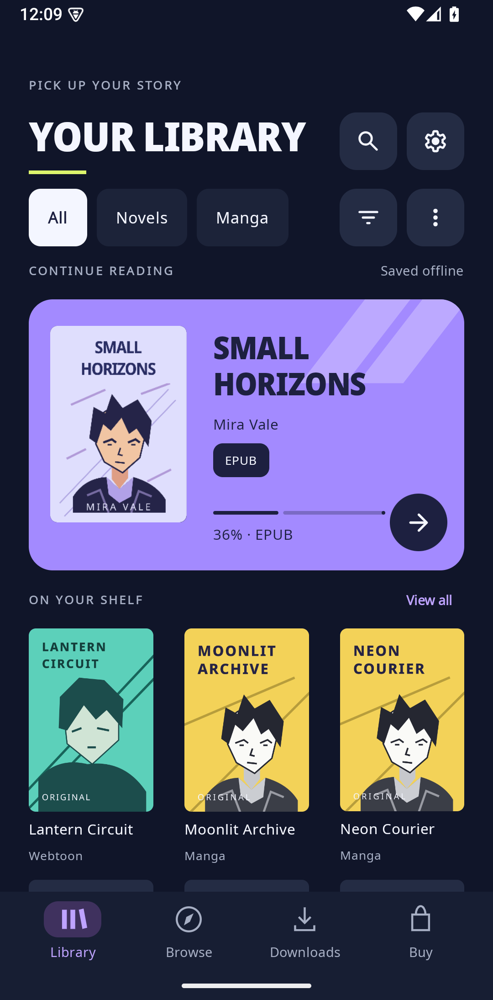
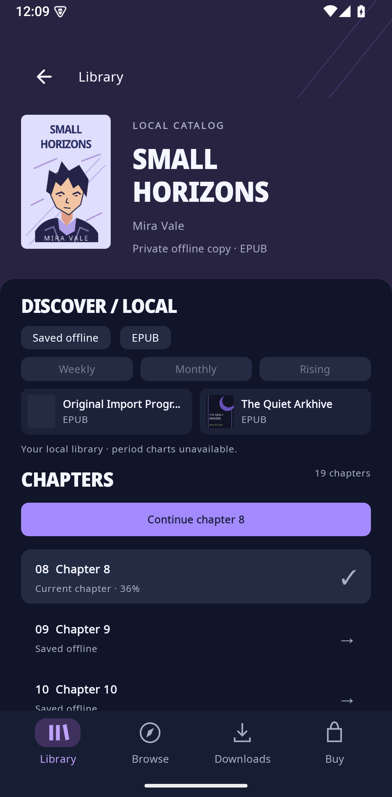
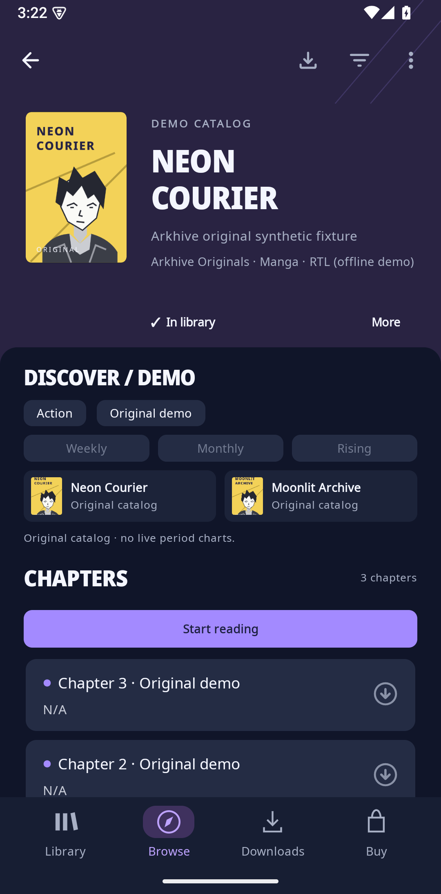
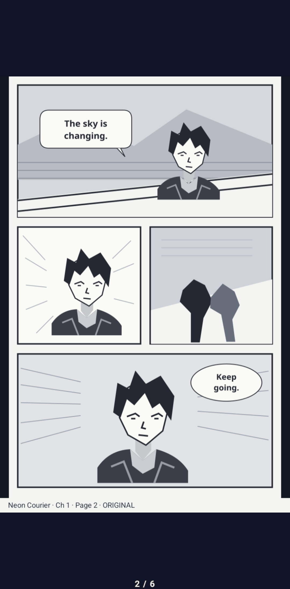
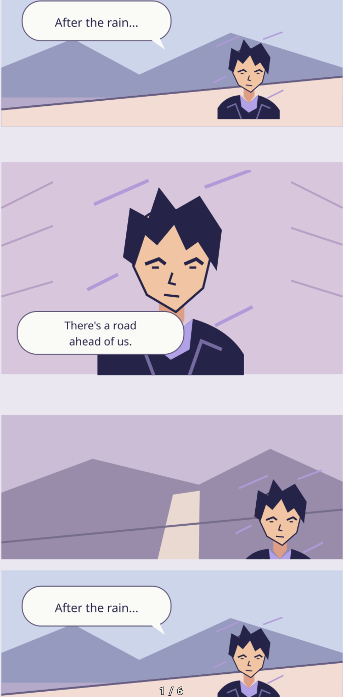
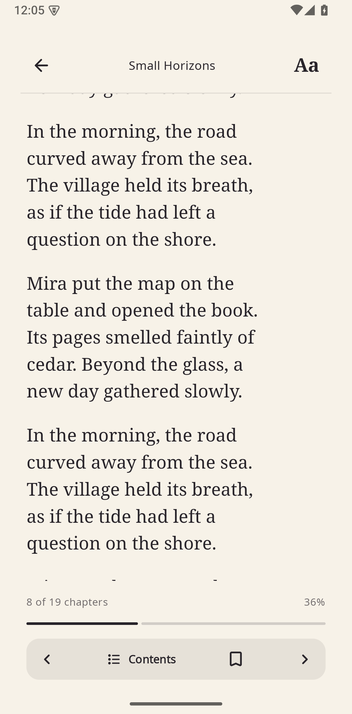
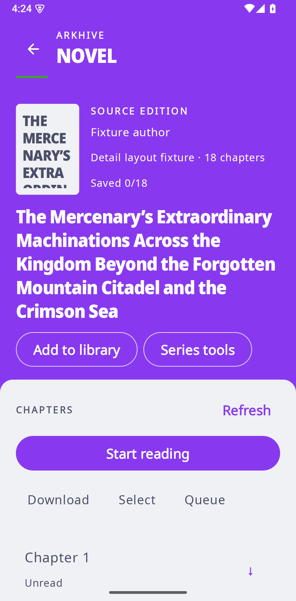
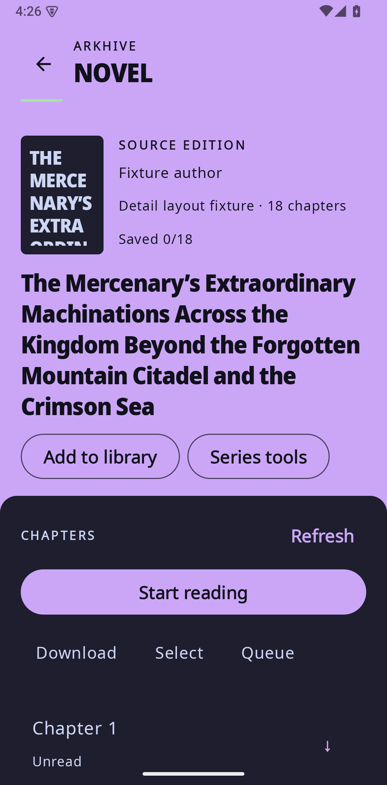

# Arkhive - Manga & Novel Reader

A cover-led Android reader for manga, manhwa, manhua, online novels, and local EPUB/PDF/text. Arkhive retains Mihon's native image reader and source host, with Readium for reflowable books.

**Current preview: 0.4.12.** This is a universal debug APK, not a production release. The Continue Reading widget fix still awaits phone launcher testing.

[Download Arkhive-0.4.12.apk](https://github.com/FrancisGiann/Arkhive/releases/download/v0.4.12/Arkhive-0.4.12.apk) · [Release notes](https://github.com/FrancisGiann/Arkhive/releases/tag/v0.4.12) · [SHA-256 file](https://github.com/FrancisGiann/Arkhive/releases/download/v0.4.12/Arkhive-0.4.12.apk.sha256)

## Install or update

1. Use Android 8 / API 26 or later. Download the APK above and compare its SHA-256 with the attached checksum.
2. Open the APK on Android. If prompted, allow installation from the browser or file manager used for this download.
3. To update the existing Arkhive preview, install over it. The package and signing certificate are unchanged; keep the existing installation to retain its data.

Internal version: **0.4.12-1**, version code **19**. Package: `dev.francisgiann.readingapp.dev`. The universal APK includes ARM64, ARMv7, x86 and x86_64 libraries. Size: **101,649,222 bytes**.

SHA-256:

~~~text
d8762e2abf96998b6000752dcd409d2782ca4227781d7991b203d2216f0364b0
~~~

The [0.4.10 preview](https://github.com/FrancisGiann/Arkhive/releases/tag/v0.4.10) was withdrawn after a launcher widget loading report. Check each release's notes before changing versions.

## Reading

- **Manga and webtoons:** RTL/LTR pages, vertical strips, native fullscreen controls, bounded tall-image rendering and single-image retry.
- **Novels and EPUBs:** saved Pages and continuous/vertical-scroll layouts, manual swipe/tap navigation, bookmarks and reading progress. A quiet bottom percentage remains visible in both modes when controls are hidden; online text reports chapter progress, while EPUB uses its publication locator.
- **Auto-read:** adjustable continuous scrolling and timed discrete steps. Interaction, backgrounding and chapter boundaries pause reading; manual advancement remains available.
- **Local imports:** EPUB, PDF and text, with import progress, exact-duplicate recognition and saved bookmarks/progress.
- **Library:** All / Novels / Comics tabs, persistent clearable filters, shelves/status, per-story reading profiles, chapter inbox, reviewed source migration, local metadata backup/restore, hidden-library reveal, static Reading Rooms and optional local reading statistics. Buying stays in a separate tab.

## Changes

- 0.4.12 makes the 2×2 Continue Reading cover grow with the card and keeps progress clear of the arrow. The large widget remains available. See the [release notes](RELEASE-NOTES-0.4.12.md) for verification limits.
- 0.4.11 repairs the Continue Reading launcher layouts and adds a true 2×2 compact option alongside the large card. See the [release notes](RELEASE-NOTES-0.4.11.md) for the phone-testing gap.
- Isolated JavaScript startup now recovers after a cancelled support check, with fresh sandbox execution and explicit trust/origin limits retained. Includes the reviewed0.4.7 zoom/scroll fixes and compact Explore action; the exact partial zoom-out/scroll sequence is now covered.

- Retains the approved full-width Discover panel with rounded top corners below the cover, with one explicit **Explore related titles** button. Related category/genre results retain context and Back navigation; synopsis/tags remain separate.
- Library labels use explicit Manga/Manhwa/Manhua metadata. Unknown or conflicting metadata is shown as Comics; source language or website does not determine nationality. The broad Library filter is now labelled Comics.
- Online novel details use a natural-case accessible title, compact metadata, responsive actions and a virtualized chapter list beneath a rounded panel.
- Accent foregrounds preserve readable colors or choose black/white for at least 4.5:1 contrast. Status-bar icons choose the higher-contrast color. Per-title reading-paper preferences are preserved.

## Verified and limits

**0.4.8:** seven focused JVM lifecycle tests and six scoped API35 x86_64 runtime methods passed. Frozen0.4.7 reproduced the reported isolated JavaScript bind error;0.4.8 passed cancellation/reconnect, repeated execution, timeout recovery and explicit trust/origin UI checks. Native partial zoom-out then forward/reverse scrolling passed in all three strip/vertical configurations, with21 actual captured frames showing painted synthetic content and no black frame in the covered sequence.

Physical-phone behavior remains unverified. Community sources, artwork sharpness, sustained performance/battery and other device/API/architecture runtimes are not established by these authored checks. **Kol Novel's `invalid source filter: genre[]` remains reference-only and is not fixed.**

[Full0.4.8 notes and download integrity](docs/releases/0.4.8.md). Earlier [0.4.6 UI/theme verification](docs/releases/0.4.6.md) remains documented separately.

## Online sources and offline reading

Wikisource is the built-in online novel source. Native Mihon extension compatibility is retained; external sources can change or fail independently. Authored API 1.4/1.6 trust fixtures do not establish that every external extension or live source works. Use sources and content you are entitled to access; there is no DRM or paywall bypass.

Online reading needs an available source and network connection unless the chapter has been saved. Temporary preload cache is **not** a saved offline chapter. Optional downloads and Smart offline can save eligible chapters, with a shared budget and queue; Smart offline is opt-in for the next 5/10 unread chapters on Wi-Fi. Local imports and completed saved chapters can be read offline. Queued, paused or failed work does not mean a chapter is available offline.

Discovery uses real Open Library catalog matches and supported source trend windows with provenance. Catalog relevance is not a popularity ranking. Unsupported rankings and unconfirmed prices remain unavailable.

## Preview validation and limits

See [0.4.12 release notes](RELEASE-NOTES-0.4.12.md) for current widget verification and limits. Existing saved reading progress and per-title paper preferences are retained.

## Repository and credits

The implementation source is published under [android/](android/), including the Gradle project, authored fixtures/tests and required license notices. The v0.4.12 tag points to this implementation snapshot. See [build instructions](android/README.md). Signing material, local build caches, credentials, user data and private QA archives are excluded.

Earlier release tags through 0.4.4 predate source publication: their automatic **Source code** archives contain the then-public documentation repository, not a matching implementation source release. The APKs and checksums attached to those releases remain unchanged.

Arkhive is based on [Mihon](https://github.com/mihonapp/mihon). Apache-2.0/Mihon, Readium BSD and Noto SIL OFL notices and upstream credits are retained in [NOTICE.md](NOTICE.md), [LICENSE](LICENSE) and [licenses](licenses).

## Sample screenshots

These six existing screenshots show original, self-authored synthetic samples from the **0.4.0 preview**. They illustrate the app and do not document every current change.

| Library | Local chapters | Manga chapters |
| --- | --- | --- |
|  |  |  |

| Manga reader | Webtoon reader | Novel reader |
| --- | --- | --- |
|  |  |  |

## Current screenshots

Final 0.4.6 authored online-novel fixture, 130% font:

| Light | Dark |
| --- | --- |
|  |  |
