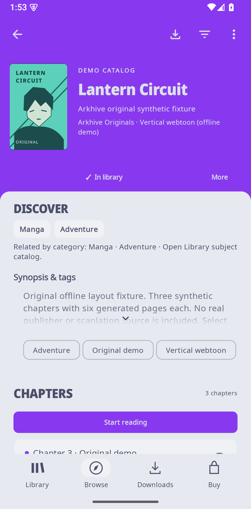
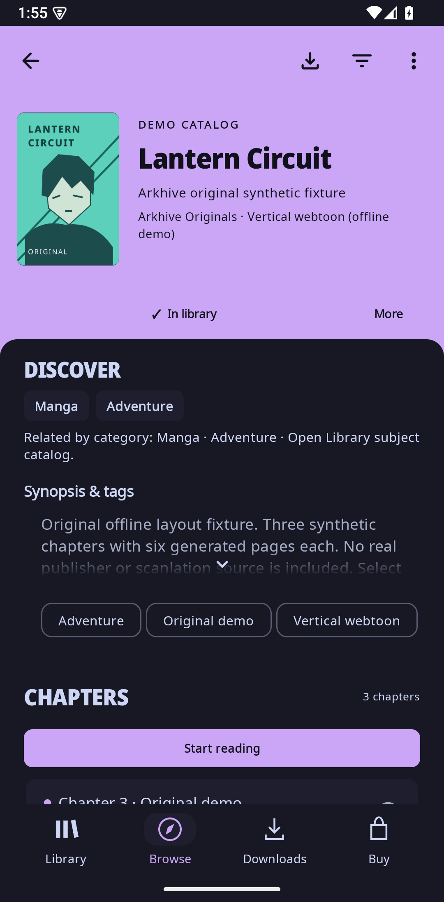

# Arkhive - Manga & Novel Reader

A cover-led Android reader for manga, manhwa, manhua, online novels, and local EPUB/PDF/text. Arkhive retains Mihon's native image reader and source host, with Readium for reflowable books.

**Current preview: 0.4.5.** This is a universal debug APK, not a production release.

[Download Arkhive-0.4.5.apk](https://github.com/FrancisGiann/Arkhive/releases/download/v0.4.5/Arkhive-0.4.5.apk) · [Release notes](https://github.com/FrancisGiann/Arkhive/releases/tag/v0.4.5) · [SHA-256 file](https://github.com/FrancisGiann/Arkhive/releases/download/v0.4.5/Arkhive-0.4.5.sha256)

## Install or update

1. Use Android 8 / API 26 or later. Download the APK above and compare its SHA-256 with the attached checksum.
2. Open the APK on Android. If prompted, allow installation from the browser or file manager used for this download.
3. To update the existing Arkhive preview, install over it. The package and signing certificate are unchanged; keep the existing installation to retain its data.

Internal version: **0.4.5-1**, version code **12**. Package: `dev.francisgiann.readingapp.dev`. The universal APK includes ARM64, ARMv7, x86 and x86_64 libraries. Size: **102,201,109 bytes**.

SHA-256:

~~~text
3aea0cb98b6bd80290ff0e019200b80feb503c70f950aa727782b3757c3f6a8c
~~~

The previous [0.4.4 preview](https://github.com/FrancisGiann/Arkhive/releases/tag/v0.4.4) remains available with its original APK and checksum. Check each release's notes before changing versions.

## Reading

- **Manga and webtoons:** RTL/LTR pages, vertical strips, native fullscreen controls, bounded tall-image rendering and single-image retry.
- **Novels and EPUBs:** saved Pages and continuous/vertical-scroll layouts, manual swipe/tap navigation, bookmarks and reading progress. A quiet bottom percentage remains visible in both modes when controls are hidden; online text reports chapter progress, while EPUB uses its publication locator.
- **Auto-read:** adjustable continuous scrolling and timed discrete steps. Interaction, backgrounding and chapter boundaries pause reading; manual advancement remains available.
- **Local imports:** EPUB, PDF and text, with import progress, exact-duplicate recognition and saved bookmarks/progress.
- **Library:** All / Novels / Manga tabs, persistent clearable filters, shelves/status, per-story reading profiles, chapter inbox, reviewed source migration, local metadata backup/restore, hidden-library reveal, static Reading Rooms and optional local reading statistics. Buying stays in a separate tab.

## New in 0.4.5

- **Original Discover panel design:** restored the full-width panel with rounded top corners below the cover header. Tapping Discover opens actual category/genre catalog matches with context, filters and a direct Back path. Synopsis and tags remain below the panel's discovery controls.
- **Long titles:** responsive stacked layout keeps words intact at narrow widths and enlarged text, with bounded ellipsis and the full accessible title.
- **Online novel status:** loading and errors are centered inside the reading area, clear of measured header/footer controls, without moving the loaded passage.
- **Exact-origin review:** paste an HTTPS page/source URL and review its exact host and port. A source's observed blocked cover host can be selected explicitly. Existing HTTPS/network restrictions and the separate Trust confirmation remain in place.

The 0.4.4 theme propagation, Light/Dark/System support, per-title paper preferences, shelf selection and reader center-tap improvements remain included.

## Online sources and offline reading

Wikisource is the built-in online novel source. Native Mihon extension compatibility is retained; external sources can change or fail independently. Authored API 1.4/1.6 trust fixtures do not establish that every external extension or live source works. Use sources and content you are entitled to access; there is no DRM or paywall bypass.

Online reading needs an available source and network connection unless the chapter has been saved. Temporary preload cache is **not** a saved offline chapter. Optional downloads and Smart offline can save eligible chapters, with a shared budget and queue; Smart offline is opt-in for the next 5/10 unread chapters on Wi-Fi. Local imports and completed saved chapters can be read offline. Queued, paused or failed work does not mean a chapter is available offline.

Discovery uses real Open Library catalog matches and supported source trend windows with provenance. Catalog relevance is not a popularity ranking. Unsupported rankings and unconfirmed prices remain unavailable.

## Preview validation and limits

All **14 focused JVM tests passed** for discovery mapping, library tools, reader status and origin normalization. Focused API 35 x86_64 emulator checks verified the restored panel in Light/Dark, contextual Discover and Back, and a 119-character title at approximately 274dp width with 130% font. The full long word remains intact and the complete title is accessible.

Reader loading/loaded/empty-source error/Retry bounds and Pages/Continuous center-tap passage preservation passed before the final panel-only styling adjustment. Those unchanged reader paths were not redundantly rerun afterward. This is scoped validation, not an exhaustive Android test suite.

The authored exact-origin fixture verified explicit observed-host selection, Cancel leaving permissions unchanged, and the rendered HTTP rejection with a greyed-out Trust control after ordinary dialog scrolling. HTTPS preview, persisted Trust and cover retry were **not completed end to end**: the automation inspected the text label rather than the disabled button's semantics, and a no-code-change debugger hold failed to attach. The four origin-normalization unit tests passed; they do not replace this unfinished UI check. No real extension permissions were changed.

Physical-phone install/update, ARM execution, API 26/36 runtime, full TalkBack, long-session battery and sustained 120fps remain unverified. Native image-reader recreation restores chapter/logical page; the inherited webtoon reader may reset the pixel offset within one tall image. Single-image retry preserves its live viewport.

## Repository and credits

The implementation source for **0.4.5 is published under [android/](android/)**, including the Gradle project, authored fixtures/tests and required license notices. The v0.4.5 tag points to the corresponding implementation snapshot. See [build instructions](android/README.md). Signing material, local build caches, credentials, user data and private QA archives are excluded.

Earlier release tags through 0.4.4 predate source publication: their automatic **Source code** archives contain the then-public documentation repository, not a matching implementation source release. The APKs and checksums attached to those releases remain unchanged.

Arkhive is based on [Mihon](https://github.com/mihonapp/mihon). Apache-2.0/Mihon, Readium BSD and Noto SIL OFL notices and upstream credits are retained in [NOTICE.md](NOTICE.md), [LICENSE](LICENSE) and [licenses](licenses).

## Sample screenshots

These six existing screenshots show original, self-authored synthetic samples from the **0.4.0 preview**. They illustrate the app and do not document every current change.

| Library | Local chapters | Manga chapters |
| --- | --- | --- |
|  |  |  |

| Manga reader | Webtoon reader | Novel reader |
| --- | --- | --- |
|  |  |  |

## Current panel screenshots

These 0.4.5 emulator captures use the original authored Lantern Circuit fixture.

| Light | Dark |
| --- | --- |
|  |  |
